# Cloudlane 移动端开发规划方案

> **版本**：V1.0  
> **编制日期**：2026-11-27  
> **适用范围**：Cloudlane 个人云端网盘系统（移动端产品规划、技术选型、PC 功能移植清单与移动端新增功能设计）  
> **前置基线**：基于已完成验收的 P0/P1 全阶段（阶段 01–14，T008–T178）及现有前后端代码架构

---

## 一、项目现状与移动端现状盘点

### 1.1 现有系统架构概览

Cloudlane 当前已建成完整的自托管个人云端网盘系统，核心技术栈与工程结构如下：

- **后端（`backend/`）**：Spring Boot 4.2 + Java 17 多模块 Maven 工程（`cloud-common` / `cloud-api` / `cloud-worker`），搭配 MySQL 8、Redis 7，可选扩展 Gotenberg（Office 转换）、Meilisearch + Apache Tika（全文检索）、FFmpeg/FFprobe（视频探测与转码）。已落地 30+ Controller，覆盖认证与设备会话、多空间、目录树闭包表、分片上传、Range 下载、多格式派生预览、共享授权、公开分享链接、SSE 实时通知、历史版本、批量作业与多存储适配（Local / S3 / DB）。
- **前端（`frontend/`）**：pnpm + Turborepo Monorepo，包含：
  - `apps/web`：PC 用户端（Vue 3 + TypeScript + Vite + Tailwind CSS + shadcn-vue / Reka UI）。
  - `apps/admin`：独立管理后台。
  - `packages/api-client`：基于后端 OpenAPI 3 自动生成的前端类型定义。
  - `packages/session`：统一的 AccessToken 管理与刷新拦截逻辑。
  - `packages/ui`：统一的设计令牌（明暗主题、五种强调色、圆角、紧凑度）与基础 UI 组件。

### 1.2 现有前端的移动端差距

尽管 `apps/web` 已内置 `MOBILE_BREAKPOINT = 760` 及侧边栏/目录树抽屉切换，但本质上仍是**桌面三栏工作台的窄屏降级**，存在以下难以通过简单 CSS 响应式解决的体验与技术瓶颈：

1. **交互范式不匹配**：PC 端重度依赖右键菜单（`ContextMenu`）、拖拽移动（DnD）、`Ctrl/Shift` 多选、行内编辑与键盘快捷键（`Ctrl+K/F/A`、`F2`、`Delete`），在触控小屏上不可用或极易误触。
2. **文件树信息密度过高**：PC 端中间栏 260px 目录树在手机上改为抽屉后，频繁展开/切换层级效率低下，不符合移动端单列钻取 + 面包屑/底部导航的直觉习惯。
3. **浏览器后台保活限制**：当前分片上传队列基于浏览器内存与 `localStorage` 记录，在手机浏览器切后台或锁屏后会被系统挂起/回收，无法稳定完成大文件续传，更无法实现相册自动备份。
4. **认证机制强耦合浏览器 Cookie**：当前 `AuthController` / `AccountController` 将刷新令牌写入 `HttpOnly; SameSite=Strict; Path=/api/v1/auth` Cookie，前端 `sessionStorage` 仅存短期 `accessToken`，并校验 `X-Requested-With: Cloudlane`。该机制对同源 H5 友好，但若开发原生 App 则需补充无 Cookie 的刷新令牌机制。

---

## 二、移动端技术路线决策：开发 H5 还是开发 App？

### 2.1 四种主流路线对比评估

结合 Cloudlane **「自托管个人云端网盘」** 的定位（用户以私有化部署为主、现有技术栈为 Java + Vue 3 Monorepo），对四种方案进行综合评估：

| 评估维度 | 方案 A：纯 H5 / PWA | 方案 B：原生 App（Swift + Kotlin） | 方案 C：跨端原生（Flutter / RN） | 方案 D：独立 Vue 3 H5/PWA + Capacitor 混合 App（推荐） |
|---|---|---|---|---|
| **与现有技术栈契合度** | 极高（直接复用 Vue 3 / TS / `@repo/*`） | 极低（需新增双端原生技术栈） | 中低（需重写全部 UI 与预览器） | **极高**（100% 复用 Vue 3 生态与共享包） |
| **研发与维护成本** | 最低（1 套代码） | 最高（2 套原生 + 1 套分享 H5） | 较高（App 代码 + 独立 H5 分享页） | **低–中**（1 套移动前端代码，同时产 H5 与 App） |
| **自托管部署与分发** | 极佳（随 Nginx 发布，扫码即用） | 差（iOS 签名/上架门槛极高） | 差（同样面临双端打包上架） | **极佳**（H5 零门槛兜底 + App 按需安装） |
| **相册自动备份** | 不支持（浏览器沙箱限制） | 完整支持 | 完整支持 | **二期通过 Capacitor 原生插件完整支持** |
| **后台大文件上传/下载** | 弱（锁屏/切后台易中断） | 完整支持 | 完整支持 | **二期通过原生传输插件完整支持** |
| **离线缓存 / 生物识别** | 受限（Cache 配额小、无原生生物锁） | 完整支持 | 完整支持 | **二期通过原生文件系统/Biometric 插件支持** |
| **系统「分享到网盘」** | 仅 Android PWA 有限支持 | 完整支持 | 完整支持 | **二期通过 Share Extension / Intent 支持** |
| **公开分享页 `/s/:token`** | 天然一体化 | 需额外维护 H5 | 需额外维护 H5 | **天然一体化** |

### 2.2 最终结论与推荐路线

**明确结论：不要在“H5”和“App”之间做非此即彼的二选一，推荐采用「先独立移动 H5/PWA，再以 Capacitor 渐进封装原生 App」的双阶段融合方案。**

核心决策依据：

1. **H5 是自托管网盘不可替代的底座**：自托管场景下，绝大多数用户部署在私有域名或内网 IP 上，iOS App Store 上架与个人证书续签成本高；同时微信/浏览器打开 `/s/:token` 公开分享链接也必须由 H5 承载。先交付高质量 H5/PWA，能让所有用户在手机浏览器中立即获得接近原生的可用体验。
2. **原生 App 能力是网盘高频刚需**：相册自动备份、锁屏后台大文件传输、离线阅读、FaceID/指纹解锁私密空间、系统级「分享到 Cloudlane」，这些能力仅靠 H5 无法突破操作系统沙箱限制，必须通过 App 形态补齐。
3. **工程复用最大化**：在现有 `frontend/` Monorepo 中新建独立应用 `frontend/apps/mobile`，直接复用 `@repo/api-client`、`@repo/session`（扩展存储适配）、`@repo/ui`（设计令牌）以及 `PDF.js`、`Viewer.js`、`xgplayer`、`markdown-it` 等已验证的预览组件。待 H5 稳定后，引入 **Capacitor** 将同一套 `apps/mobile` 构建为 Android APK 与 iOS IPA，仅针对相册、后台传输、离线存储、生物识别接入原生插件。
4. **为什么不直接在 `apps/web` 做响应式改造**：PC 端 `apps/web` 承载了大量桌面重交互代码（虚拟树、拖拽、快捷键、右键菜单、桌面宽屏布局），强行耦合移动交互会导致代码复杂度失控且包体积臃肿；拆分为独立 `apps/mobile`（挂载路径 `/m/`）后，PC 与移动端各自保持清晰演进，且可按设备 UA 自动引导跳转（同时允许用户手动切换桌面版/移动版）。

### 2.3 技术决策记录（ADR）：为什么选 Vue 3 + Capacitor 而不是 uni-app？

| 对比维度 | Vue 3 + Vite + Capacitor（已选定） | uni-app（Vue 3 / uni-app x） |
|---|---|---|
| **复用现有预览器** | 零成本复用 `PDF.js`、`Viewer.js`、`xgplayer`、`markdown-it`、`highlight.js`、`DOMPurify` 与 Fetch SSE（均依赖标准 DOM）。 | App 端（nvue / uni-app x）无标准 DOM，重度预览需绕道 `web-view` 或 `renderjs`，通信繁琐、体验割裂。 |
| **Monorepo 融合度** | 直接作为 `frontend/apps/mobile`，无缝消费 Tailwind v4、`@repo/api-client`、`@repo/session`、`@repo/ui`。 | 独立编译体系（`view`/`text` 标签、pages.json、条件编译），无法直接复用 Tailwind v4 与 Reka UI。 |
| **开源与 CI/CD** | 纯开源标准原生工程（Android Studio / Xcode），支持脚本与 GitHub Actions 自动化打包。 | 强绑定 HBuilderX 与 DCloud 云打包，离线打包配置繁琐。 |
| **微信小程序** | 不支持（覆盖 H5/PWA + Android + iOS）。 | 支持；但自托管网盘无法满足小程序企业主体/固定备案域名/严格网盘类目限制，故不作为刚需。 |

**结论冻结**：除非未来转型为官方统一托管的 SaaS 并强依赖微信小程序，否则坚定采用 **Vue 3 + Vite + Capacitor** 路线。

---

## 三、PC 端功能全景梳理与移动端移植清单

下表完整盘点 Cloudlane 现有 PC 端（P0/P1 已实现）全部 13 个功能域，明确每个功能在移动端的**移植策略**与**交互适配方式**。

> **移植策略说明**：  
> - **完整移植**：核心能力 1:1 保留，按移动端视觉重排。  
> - **交互重构移植**：业务能力保留，但桌面交互（右键、拖拽、三栏、快捷键）重构为触控交互（底部弹窗、手势、单列钻取）。  
> - **精简移植**：保留高频子集，弱化或折叠低频复杂配置。  
> - **暂不移植 / 引导 PC**：属于重度桌面生产力或后台运维能力，移动端不优先投入。

### 3.1 认证与账户安全

| PC 端现有功能 | 移植策略 | 移动端适配说明 |
|---|---|---|
| 邮箱密码登录 / 注册 / 邮箱验证码 | 完整移植 | 单屏表单 + 移动软键盘优化（`inputmode="email"`、密码显隐切换） |
| 忘记密码 / 邮件重置密码 | 完整移植 | 完整保留，支持从邮件链接直接唤起移动端重置页 |
| 刷新会话与自动续期 | 交互重构移植 | H5 复用 Cookie；App 阶段扩展安全存储 Refresh Token 模式 |
| 个人资料修改（昵称、头像上传） | 完整移植 | 头像选择直接支持调用手机相册或现场拍照裁剪 |
| 登录密码修改 | 完整移植 | 保留，修改后触发当前外其余会话失效 |
| 活跃登录设备列表与远程下线 | 完整移植 | 卡片式展示设备型号、IP、活跃时间，支持左滑或按钮一键踢出 |

### 3.2 多空间管理

| PC 端现有功能 | 移植策略 | 移动端适配说明 |
|---|---|---|
| 个人空间 / 共享空间混排导航与角色徽章 | 交互重构移植 | 由 PC 左侧栏改为顶部「空间切换下拉面板」或「文件」Tab 首屏空间卡片列表 |
| 创建 / 编辑空间（名称、图标、颜色、描述、排序） | 精简移植 | 通过底部弹窗（Bottom Sheet）配置核心属性；排序改为上下移动按钮或长按拖拽 |
| 删除空间（名称二次确认） | 完整移植 | 保留严格名称输入确认防误删 |
| 个人空间与共享空间互转 | 精简移植 | 收纳至「空间设置」二级页中 |

### 3.3 文件浏览、导航与筛选

| PC 端现有功能 | 移植策略 | 移动端适配说明 |
|---|---|---|
| 三栏布局（导航 + 260px 目录树 + 文件区） | 交互重构移植 | 重构为**底部 Tab 导航（首页/文件/共享/我的）+ 单列钻取浏览**，彻底移除常驻目录树 |
| 面包屑导航与路径折叠 | 交互重构移植 | 顶部横向可滚动面包屑条，点击任意层级快速返回，左滑边缘支持返回上一级 |
| 列表视图 / 网格视图切换 | 完整移植 | 列表视图展示单行文件名+大小+时间；网格视图采用 2–3 列大图缩略图（适配图片/视频目录） |
| 目录内文件分类统计标签与组合筛选 | 完整移植 | 顶部横向胶囊筛选条（全部 / 图片 / 视频 / 文档 / 音频 / 压缩包等） |
| 名称 / 修改时间 / 大小排序 | 完整移植 | 顶部排序切换按钮弹出 Bottom Sheet 选择排序字段与升降序 |
| 分页加载（10 万节点大目录支持） | 交互重构移植 | 由 PC 页码分页改为**上拉无限滚动加载（Infinite Scroll）+ 虚拟列表** |
| 文件详情侧栏 | 交互重构移植 | 改为从更多菜单唤起的「文件详情」底部半屏弹窗 |

### 3.4 文件基础操作与批量能力

| PC 端现有功能 | 移植策略 | 移动端适配说明 |
|---|---|---|
| 新建文件夹（行内占位行） | 交互重构移植 | 改为点击右下角 FAB（`+`）唤起弹窗输入文件夹名 |
| 右键菜单 / 三点菜单 | 交互重构移植 | 改为**列表项右侧三点图标**或**长按条目**唤起底部动作面板（ActionSheet） |
| 重命名（行内编辑） | 交互重构移植 | 改为弹窗重命名，自动选中主文件名（保留扩展名） |
| 拖拽移动 | 交互重构移植 | 移除拖拽，改为操作菜单中的「移动 / 复制」，弹出简洁的目录层级选择器 |
| 跨空间移动 / 复制 | 完整移植 | 目录选择器顶部支持切换目标空间 |
| 收藏 / 固定到快捷访问 | 完整移植 | 操作菜单一键收藏/置顶，聚合在「首页」快捷入口 |
| 逻辑删除与 10 秒撤销条 | 完整移植 | 底部 Toast 浮条展示「已移至回收站 · 撤销」，10 秒内可一键回滚 |
| 隐藏文件 / 文件夹（需密码验证显示） | 完整移植 | 在「我的 / 安全设置」或目录更多菜单中验证密码（App 端支持生物识别）临时显示 |
| 多选模式与批量移动/复制/删除 | 交互重构移植 | 长按任意文件进入多选态，顶部显示全选/取消，底部切换为批量操作栏 |
| 批量 ZIP 打包下载 | 精简移植 | 保留服务端打包接口调用，提示打包完成后触发下载或转存 |
| 批量重命名（前缀/后缀/替换/序号） | 暂不移植 | 属于重度桌面整理场景，移动端输入规则成本高，保留在 PC 端 |
| 全局键盘快捷键（Ctrl+K/F/A 等） | 不移植 | 移动端无物理键盘依赖，全部映射为可见触控入口 |

### 3.5 上传、下载与任务中心

| PC 端现有功能 | 移植策略 | 移动端适配说明 |
|---|---|---|
| 多文件分片上传 + SHA-256 校验 + 断点续传 | 完整移植 | 接入现有 `/v1/uploads` 分片协议；支持上传前选择目标目录 |
| 文件夹上传与目录结构还原 | 精简移植 | H5 端受移动端浏览器限制不主推；App 阶段按需开放 |
| 拖拽上传 | 不移植 | 移动端改为 FAB「+」菜单：上传照片/视频、上传文件、拍照上传 |
| 传输与任务中心（进行中/已完成/失败/服务端会话） | 完整移植 | 独立「传输列表」页，支持单任务暂停/继续/重试/取消及全部暂停 |
| HTTP Range 断点下载 | 完整移植 | H5 触发浏览器下载；App 阶段写入本地沙箱并支持「用其他应用打开」 |

### 3.6 全格式在线预览

| PC 端现有功能 | 移植策略 | 移动端适配说明 |
|---|---|---|
| 图片预览（缩放、旋转、翻转、上下张切换） | 交互重构移植 | 全屏沉浸式浏览，支持双指捏合缩放、双击放大、左右滑动切换上下张、下滑关闭 |
| PDF 阅读（分页、缩放、目录、全文搜索） | 交互重构移植 | 竖向连续滚动阅读，双指缩放，顶部/底部轻触呼出工具栏（页码、目录抽屉、搜索） |
| Markdown / 纯文本 / 代码预览（大文本分段加载） | 完整移植 | 自动换行默认开启，优化代码块横向滚动与阅读字号切换 |
| 音频播放（倍速、进度条） | 交互重构移植 | 支持后台/悬浮迷你播放条与 0.5x–2x 倍速 |
| 视频播放（xgplayer、FFprobe 策略、转码状态/重试） | 交互重构移植 | 支持竖屏/横屏全屏切换、倍速、手势进度/亮度/音量调节 |
| Word / PPT（Gotenberg 转 PDF 预览） | 完整移植 | 复用移动端 PDF 阅读器，PPT 支持横屏全屏翻页浏览 |
| Excel 预览（多 Sheet、分段虚拟滚动、PDF 打印模式） | 精简移植 | 移动端默认提供「表格轻量浏览 + PDF 模式一键切换」，大表格优先推荐横向滑动或 PDF 模式 |
| 压缩包预览（ZIP/TAR 目录浏览与按需提取） | 完整移植 | 单列目录钻取浏览包内文件，点击单文件按需提取预览/下载 |
| 不支持格式兜底页 | 完整移植 | 展示文件信息与下载 / 调用系统第三方 App 打开 |

### 3.7 协同共享、公开分享与消息中心

| PC 端现有功能 | 移植策略 | 移动端适配说明 |
|---|---|---|
| 共享空间成员列表、邀请、修改角色、移除成员 | 完整移植 | 列表卡片展示成员与角色，底部弹窗邀请与改权限 |
| 任意文件夹共享授权与撤销 | 完整移植 | 从文件操作菜单直接发起共享 |
| 共享中心（与我共享 / 我发起的共享 / 分享链接） | 完整移植 | 独立底部 Tab「共享」，顶部三段式 Segmented Tab 切换 |
| 共享邀请接受 / 拒绝 | 完整移植 | 在共享中心顶部及站内消息中均可一键接受/拒绝 |
| 创建公开分享链接（有效期、提取码、下载限制） | 完整移植 | 底部弹窗快速生成，支持一键复制「链接 + 提取码口令」与生成二维码 |
| 独立公开分享页（`/s/:token`） | 完整移植并强化 | **核心流量入口**：重构移动端排版，支持免登录极速预览图片/PDF/视频/文本及保存 |
| 站内消息中心与 SSE 实时推送 | 完整移植 | 顶栏铃铛角标 + 独立消息列表页，支持单条/全部已读与点击直达目标页面 |

### 3.8 搜索、历史版本、私密空间与回收站

| PC 端现有功能 | 移植策略 | 移动端适配说明 |
|---|---|---|
| 全局搜索与全文检索（Meilisearch + Tika 摘要） | 完整移植 | 独立全屏搜索页，支持历史搜索词、跨空间/类型筛选、正文命中高亮及一键定位/预览 |
| 最近使用 / 我的收藏 / 快捷访问 | 完整移植 | 聚合至「首页」Tab，方便手机端单手快速直达常用文档 |
| 文件历史版本（列表、预览、恢复、版本上限） | 完整移植 | 在文件更多菜单 ->「历史版本」中查看、预览旧版与一键恢复 |
| 私密空间（密码解锁、空闲超时、立即锁定、隐藏项管理） | 完整移植并强化 | 独立加密入口；App 阶段叠加 FaceID/指纹解锁与后台隐私模糊 |
| 回收站（还原、彻底删除、清空） | 完整移植 | 收纳至「我的 -> 回收站」，支持多选批量还原或清理 |
| 外观主题（浅色/深色/跟随系统、强调色） | 完整移植 | 复用 `@repo/ui/theme` 令牌，移动端默认适配系统深色模式与安全区（Safe Area） |

### 3.9 管理后台（`/admin`）

| PC 端现有功能 | 移植策略 | 移动端适配说明 |
|---|---|---|
| 仪表盘、用户管理、存储配置、站点/认证/文件策略、Worker 任务、审计日志 | 暂不完整移植 | 管理后台表单复杂、数据表宽，移动端不做完整搬运。仅在「我的」中为 `SUPER_ADMIN` 保留**轻量只读概览入口**（存储容量水位、用户数、失败任务告警、快捷发布系统消息），复杂配置引导至 PC 浏览器操作。 |

---

## 四、移动端专属新增功能规划

除移植 PC 端能力外，围绕手机端「随身拍摄、碎片查阅、移动弱网、社交互传、隐私随行」五大高频场景，规划以下移动端独有新增功能：

### 4.1 核心刚需级（M1–M2 优先落地 / M3 原生补齐）

1. **随手拍 / 文档扫描即传（M1 H5 基础 + M3 App 增强）**
   - **即拍即传**：FAB 菜单提供「拍照上传」「录像上传」「录音备忘」，直接调用系统摄像头/麦克风并上传至当前目录。
   - **纸质文档扫描（M3）**：拍摄白板、发票、合同，自动边缘检测、透视纠偏、增强对比度并合成多页 PDF 直接入库，无缝对接现有全文检索（Tika OCR/文本索引）。
2. **相册自动备份与「云端相册」时光轴（M3 App 核心杀手级功能）**
   - **后台增量备份**：按相册目录选择备份范围，支持「仅 Wi-Fi 备份」「仅充电时备份」「保留原图/实况照片」。
   - **SHA-256 秒传去重**：联动原计划 P2（T179–T181）的用户级文件去重与秒传能力，避免重复上传浪费流量与空间。
   - **时光轴瀑布流视图**：新增独立「相册」视图，按拍摄日期（年/月/日）聚合所有空间（排除私密与隐藏项）中的图片与视频，支持时间轴快速拖拽定位。
3. **离线缓存与无网阅读（M3 App 核心）**
   - 文件菜单新增「设为离线可用」，将文件加密缓存至本地沙箱，地铁、航班等无网环境下可正常打开 PDF、图片、音视频与 Office 预览件。
   - 同步检测服务端 `revision` / `currentVersionId` 变化，联网后自动提示更新离线副本；支持在设置中配置缓存上限与一键清理。
4. **生物识别安全锁与防偷窥保护（M3 App 核心）**
   - **FaceID / 指纹解锁**：支持用生物识别替代手动输入密码，快速解锁「私密空间」与「显示隐藏项」（底层绑定设备安全密钥，后端仍签发短期 `privateToken`）。
   - **应用启动锁 & 后台隐私遮罩**：切回桌面或多任务卡片视图时自动高斯模糊画面，防止旁人窥屏。
5. **系统级「分享到 Cloudlane」与外部应用打开（M3 App 核心）**
   - 注册 Android Intent / iOS Share Extension：在微信、浏览器、系统相册点击「分享 -> 存至 Cloudlane」，无需先打开网盘即可直接选择目录上传。
   - 对不支持在线编辑的格式（如本地笔记、CAD、压缩包内文档），支持下载后一键调用手机已安装的第三方 App 打开。

### 4.2 体验增强级（M1–M2 即可在 H5 落地）

6. **扫码登录 PC 端与跨端接力（M2）**
   - **扫码登录**：PC 登录页展示动态二维码，手机端「扫一扫」确认授权即可免输密码登录 PC，同时自动写入设备会话表。
   - **跨端进度接力**：记录视频播放进度、PDF 上次阅读页码至用户偏好/扩展表，实现手机看一半、PC 接着看。
7. **移动网络与流量保护（M1）**
   - 提供「仅 Wi-Fi 自动上传/下载」「蜂窝网络播放大视频前提示」开关。
   - 列表与网格缩略图按手机 DPR 请求合适尺寸（复用 `/preview/thumbnail?width=240`），大幅降低流量消耗。
   - 监测 `online/offline` 与网络类型变化，弱网断连自动暂停分片队列，恢复网络后自动续传。
8. **社交友好分享与一键转存（M1–M2）**
   - 生成分享链接时，自动组装「文件名 + 链接 + 提取码 + 有效期」的微信友好口令文本，并支持生成分享二维码图片。
   - 公开分享页 `/s/:token` 登录态用户新增「一键转存到我的空间」功能，免去先下载再上传的繁琐步骤。
9. **沉浸式移动媒体体验（M2）**
   - **音频悬浮播放条**：退出音频预览页后在底部保留迷你播放条，支持浏览其他目录的同时后台听歌/听播客，并接入浏览器 Media Session API（锁屏切歌/暂停）。
   - **视频手势控制**：横屏全屏下支持左侧上下滑调亮度、右侧上下滑调音量、左右滑快进快退、长按 2 倍速、屏幕锁定防误触。

---

## 五、移动端信息架构与工程落地方案

### 5.1 移动端信息架构（底部 4 Tab + FAB）

```mermaid
flowchart TB
    App["Cloudlane 移动端 (apps/mobile)"] --> T1["首页"]
    App --> T2["文件"]
    App --> T3["共享"]
    App --> T4["我的"]
    App --> FAB["悬浮按钮 (+)"]

    T1 --> T1A["全局搜索栏"]
    T1 --> T1B["快捷访问 / 收藏"]
    T1 --> T1C["最近使用"]
    T1 --> T1D["云端相册入口 (M3)"]

    T2 --> T2A["顶部空间切换器 (个人/共享混排)"]
    T2 --> T2B["面包屑 + 分类筛选 + 排序"]
    T2 --> T2C["单列列表 / 网格视图"]
    T2 --> T2D["长按多选 + 底部批量栏"]

    T3 --> T3A["与我共享"]
    T3 --> T3B["我发起的共享"]
    T3 --> T3C["分享链接管理"]
    T3 --> T3D["待处理共享邀请"]

    T4 --> T4A["个人资料与容量条"]
    T4 --> T4B["传输任务中心 / 离线文件"]
    T4 --> T4C["私密空间 (密码/生物锁)"]
    T4 --> T4D["回收站 / 消息中心"]
    T4 --> T4E["安全设置 / 主题 / 流量策略"]
    T4 --> T4F["扫一扫登录 PC / 轻量后台概览"]

    FAB --> F1["上传照片/视频"]
    FAB --> F2["拍照/扫描上传"]
    FAB --> F3["上传本地文件"]
    FAB --> F4["新建文件夹"]
```



### 5.2 前端 Monorepo 目录规划

在现有 `frontend/` 下新增 `apps/mobile`，最大化复用现有共享包：

```text
frontend/
├─ apps/
│  ├─ web/                     # 现有 PC 用户端 (挂载 /)
│  ├─ admin/                   # 现有管理后台 (挂载 /admin/)
│  └─ mobile/                  # 新增移动端 H5 + Capacitor App (挂载 /m/)
│     ├─ src/
│     │  ├─ views/             # 首页 / 文件 / 共享 / 我的 / 预览 / 搜索 / 认证 / 公开分享
│     │  ├─ components/        # BottomSheet / FileRow / MediaGrid / FloatingAudioBar 等
│     │  ├─ native/            # 平台能力抽象层 (Web H5 实现 vs Capacitor 原生实现)
│     │  └─ router/            # 移动端路由与页面切换过渡动画
│     ├─ public/manifest.webmanifest  # PWA 清单与图标
│     ├─ capacitor.config.ts   # M3 引入：iOS / Android 打包配置
│     └─ package.json
└─ packages/
   ├─ api-client/              # 复用：OpenAPI 生成类型
   ├─ session/                 # 扩展：支持自定义 TokenStorage (sessionStorage / Capacitor Preferences)
   ├─ ui/                      # 复用：主题令牌与基础样式
   └─ drive-core/              # 建议抽离：上传队列状态机、预览路由注册、格式化与错误码工具
```

> **UI 组件选型（已确定）**：采用 **Vant 4 + 桥接现有 `@repo/ui` 主题令牌**（通过 `src/styles/vant-theme.css` 将 `--van-*` 映射至 `--primary`/`--background`/`--card`/`--foreground`/`--border` 等变量，并随明暗模式自动切换 `.van-theme-dark`），兼顾开箱即用的移动端原生手感与全站视觉统一。

### 5.3 后端最小化配套改造清单

现有后端 API 已覆盖移动端 85% 以上的业务需求，仅需补充少量面向移动端的增量能力：

| 改造项 | 涉及模块 | 改造内容 | 阶段 |
|---|---|---|---|
| **双模式会话刷新** | `AccountController` / `AuthController` / `WebSessionService` | 保留 Web `HttpOnly Cookie` 刷新模式；新增移动端安全模式（`X-Client-Type: MOBILE_APP` 时在登录/刷新响应体返回 `refreshToken`，刷新接口兼容从 Header/Body 读取），并在设备会话中区分 `WEB` / `MOBILE_H5` / `IOS` / `ANDROID`。 | M1/M3 |
| **Nginx 路由挂载** | `frontend/nginx.conf` | 新增 `/m/` 静态资源路由（`try_files $uri $uri/ /m/index.html`），可选增加移动端 UA 引导提示条（不强制死锁，允许用户切换桌面版）。 | M1 |
| **公开分享一键转存** | `ShareLinkController` | 新增 `POST /api/v1/public/shares/{token}/save`，允许登录用户将公开分享的文件/文件夹直接深拷贝转存到自己指定空间目录。 | M2 |
| **扫码登录接口** | `AuthController` / Redis | 新增二维码票据生成、状态查询/SSE、移动端扫码确认授权接口，签发 PC 端会话。 | M2 |
| **阅读/播放进度同步** | `UserPreferenceController` 或新表 | 记录文件最后阅读页码/视频播放秒数，支撑跨端接力。 | M2 |
| **媒体元数据与时光轴接口** | `cloud-worker` / `DriveController` | 上传图片/视频后异步提取 EXIF 拍摄时间、宽高、时长，提供按日期倒序分页的媒体时光轴查询接口。 | M3 |
| **用户级 SHA-256 秒传** | `UploadController`（联动原 P2 T179–T181） | 初始化上传前支持提交文件 SHA-256 校验，用户已有相同物理对象时直接秒传，极大优化相册备份体验。 | M3 |

---

## 六、分阶段实施路线图

| 阶段 | 目标与交付物 | 核心内容 | 预计周期 |
|---|---|---|---|
| **M1：移动 H5/PWA 基础版（MVP）** | 上线 `/m/` 移动 Web 版，手机浏览器扫码即用 | Monorepo 初始化 `apps/mobile`、抽离 `drive-core`；登录注册；底部 4 Tab 架构；多空间切换与文件单列/网格浏览；上传/下载/新建/重命名/移动/删除与 10 秒撤销；图片/PDF/视频/音频/Markdown/Office 基础预览；公开分享页 `/s/:token` 移动端重构；PWA 添加到主屏幕与流量保护开关。 | 3–4 周 |
| **M2：协作、安全与效率完善** | 追平 PC 端全部日常高频能力 | 完整共享中心（与我共享/我发起的/分享链接/邀请处理）；全文检索页与高亮定位；私密空间与隐藏项；历史版本预览/恢复；回收站；批量多选操作；站内消息中心与 SSE；音频悬浮播放条；扫码登录 PC；公开分享一键转存；超管轻量只读概览。 | 2–3 周 |
| **M3：Capacitor 原生 App 封装** | 发布 Android APK / iOS IPA，补齐原生体验 | 集成 Capacitor 与移动端无 Cookie Token 刷新；相册自动增量备份 + 时光轴视图 + SHA-256 秒传；后台保活分片上传/下载；离线缓存与无网阅读；FaceID/指纹解锁私密空间与后台模糊；系统「分享到 Cloudlane」与文档扫描转 PDF。 | 3–4 周 |

---

## 七、风险与注意事项

1. **大文件与内存控制**：移动端浏览器内存远低于 PC，PDF.js 渲染与图片预览需限制同时驻留的 Canvas/ObjectURL 数量，离开预览页及时 `URL.revokeObjectURL`。
2. **私密空间与离线缓存安全**：私密空间内的文件默认**禁止**进入离线缓存、云端相册时光轴与系统缩略图缓存，防止绕过密码验证泄露隐私。
3. **跨端兼容与契约防漂移**：`apps/mobile` 严格消费 `@repo/api-client` 生成类型，纳入现有 `pnpm api:check` 与 CI 检查流程，确保 PC 端、管理后台与移动端三端接口契约始终一致。
