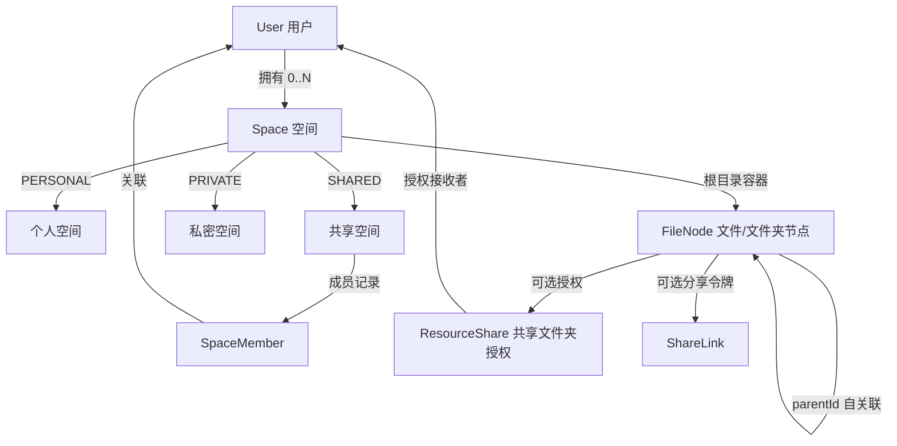
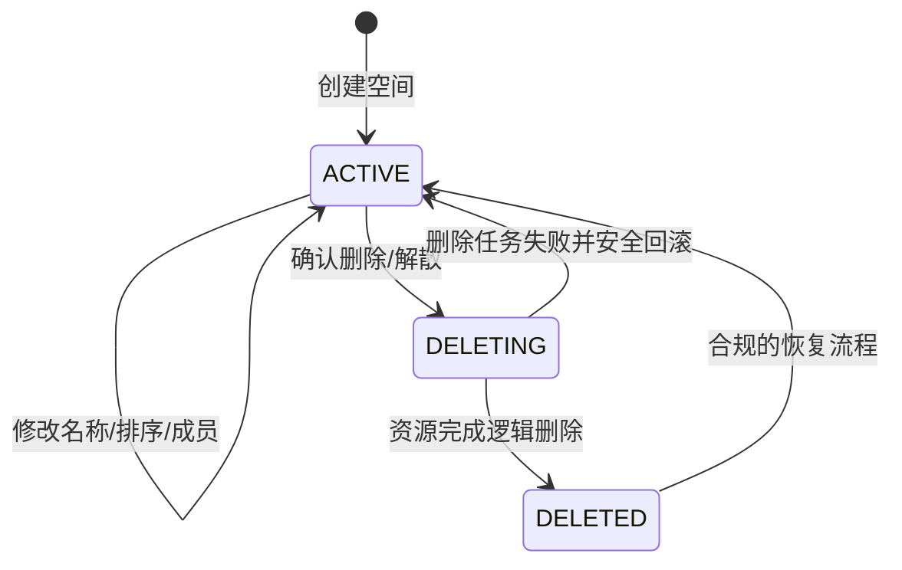

# T002｜个人、共享与私密空间：概念、归属和生命周期

> 阶段 00 · 设计基线 V1.0 · 适用于空间/权限/文件/导航模块

## 1. 不混淆的四个概念

| 概念 | 定义 | 资源是否独立 | 是否原地保留 |
|---|---|---|---|
| **个人空间 PERSONAL** | 某用户所有的一级资源容器，具有自己的目录根 | 是 | 是 |
| **共享空间 SHARED** | 仍有明确所有者、具备成员关系的一级资源容器 | 是 | 是 |
| **私密空间 PRIVATE** | 带二次验证与独立解锁状态的空间 | 是 | 是 |
| **共享文件夹** | 对一个既有文件夹的**授权关系**，不是一种新的空间 | 否，复用源目录 | 是 |

公共链接分享也不是空间/文件夹的新副本；只是对资源的受控访问凭证。

## 2. 逻辑模型

### 2.1 所有权与访问权
- `space.owner_user_id` 表示空间所有者，不等于所有能访问该空间的人。
- 空间成员 `space_member` 只在 SHARED 空间使用；受邀成员没有空间所有权。
- 文件的权威归属由 `file_node.space_id` 确定；`created_by` 是审计身份，不用于替代所有权。
- 共享文件夹仍在它的原始空间中；接收方通过 ResourceShare 获得**作用于某个目录子树**的访问权。
- 个人空间默认仅所有者可访问；若某文件夹单独共享，空间整体仍是个人空间。
- 私密空间在首期不允许共享空间成员、文件夹授权或公开分享链接。

## 3. 空间基本字段（概念层）

| 字段 | 约束 | 说明 |
|---|---|---|
| `id` | 全局唯一 | 空间 ID |
| `ownerUserId` | 非空 | 资源归属人 |
| `kind` | PERSONAL / SHARED / PRIVATE | 空间类型 |
| `name` | 1—50 字符；同用户重名策略待统一 | 显示名 |
| `icon`, `color` | 可选 | 导航视觉标记 |
| `description` | 可选 | 用途描述 |
| `sortOrder` | 可修改 | 所有者的导航排序；受邀者可拥有自己的显示偏好 |
| `status` | ACTIVE / DELETING / DELETED | 生命周期 |
| `createdAt`, `updatedAt` | UTC 时间 | 审计字段 |

空间不作为普通 `FileNode` 伪装在目录树中，根节点使用 `parentId=0` 表达；跨空间目录移动必须同时变更后代 `spaceId`，或者先明确设计异步作业策略。

## 4. 生命周期状态机

### 4.1 创建
- 新用户注册后创建一个默认 PERSONAL「我的空间」（同一业务事务或可靠补偿流程）。
- 用户可创建多个 PERSONAL/SHARED；PRIVATE 需要先完成独立验证初始化。
- 所有创建动作先校验容量、空间数及后台政策（若有）。

### 4.2 PERSONAL → SHARED
- 保持相同 Space ID 和原文件树，不复制内容。
- 将 `kind` 转为 SHARED，并创建所有者成员记录。
- 后续通过邀请产生其他成员。
- 转换时不改变文件节点、版本号与物理 Key。

### 4.3 SHARED → PERSONAL
默认不开放一键逆转。只有所有者移除全部其他成员、处理已有共享授权后，才可申请逆转，且必须二次确认。

### 4.4 成员退出、移除与转让
- 普通成员退出：只删除本人有效成员访问关系，不影响空间数据。
- 所有者不能直接退出而留下无所有者空间；先完成所有权转让。
- 成员被移除后：API 权限立即失效，导航、搜索、快捷引用及缓存按权限失效处理。
- 管理者不能移除或替代空间所有者。
- 所有权转让必须经双方确认或遵从严格的管理员应急流程，并记录审计。

### 4.5 删除与解散
- 个人空间删除：显示涉及的文件/文件夹数量，先逻辑删除并提供恢复期限。
- 共享空间解散：仅所有者可执行，提前通知成员；其共享入口同步失效。
- 必须区分「退出空间」「移除成员」「取消共享」「删除源文件夹」「删除空间」。
- 物理存储对象仅在全部版本/引用解除并完成安全宽限期后清理。

## 5. 跨空间移动与复制

| 操作 | 资源归属 | 物理文件 | 授权影响 |
|---|---|---|---|
| 个人 → 个人移动 | 更改 Space ID、父级引用 | 默认不移动 Blob | 原目录共享授权默认不跟随迁走，需显式重新授权 |
| 个人 → 共享移动 | 移至目标共享空间并计入目标配额 | 默认不复制物理对象 | 按目标空间权限计算 |
| 共享 → 个人移动 | 需来源允许移出且目标允许写入 | 具体存储可保持不动 | 不能用于绕过他人授权与所有权策略 |
| 跨空间复制 | 新建 FileNode（及所需版本引用） | 可复用 Blob，受去重策略约束 | 不自动复制成员列表或链接凭证 |

默认规则：**跨所有者空间移动可能造成所有权转移，首期禁止普通共享成员直接执行这类移动**；可使用有权限的「复制」操作，并明确副本归属。

## 6. 共享文件夹的虚拟根

假设：A 用户拥有 `工作空间/项目/设计资料`，将 `设计资料` 共享给 B。

- A 仍通过原路径查看。
- B 在「共享中心 → 与我共享」看见 `设计资料` 这个虚拟根。
- B 的面包屑从 `共享中心/设计资料` 开始，不允许点到 A 的 `项目` 或 `工作空间`。
- B 可将此根固定「快捷访问」，但这只存 `shareId` 或安全的资源引用，不复制 FileNode。
- 撤销共享时 B 的收藏/快捷入口需在权限层失效，不依赖 UI 是否更新。

## 7. 隐藏与私密边界
- `hidden` 是普通空间节点的**默认可见性属性**，不等于加密。
- 隐藏文件/目录默认不允许被新建分享授权、固定快捷访问；在已共享父目录下新增隐藏子项，也不得自动对共享成员可见。
- PRIVATE 空间需要独立服务器端解锁会话；即使获得直接文件 ID 也不允许读取。
- 私密内容的缩略图、正文索引、预览缓存和临时 URL 受同等验证规则约束。

## 8. 需要明确的策略默认值
- 共享空间容量计入所有者配额，而非上传成员配额。
- 默认一个用户有一个初始个人空间，可创建多个额外空间。
- 同用户空间名称建议允许重名，但导航显示唯一辅助标识；若产品偏好不允许重名，可在数据模型落地前改为唯一约束。
- 管理员**不是**所有私密资源的默认读者。

## 9. 验收用例
1. A 创建两个个人空间，同名文件夹互不干扰。
2. A 转换某空间为共享，原有文件 ID/版本/存储引用均不变。
3. A 邀请 B，B 接受后空间与自己的空间同列出现并标识「共享」。
4. B 被移除，旧 API URL、搜索、分享派生预览均不能继续访问。
5. A 分享五级目录下的子文件夹给 B，B 无法通过面包屑遍历授权根之外的祖先。
6. 私密空间无法以共享文件夹方式暴露。

**T002 完成定义：空间类型、归属、成员、子树共享与删除/转换规则已形成一致的业务边界。**
