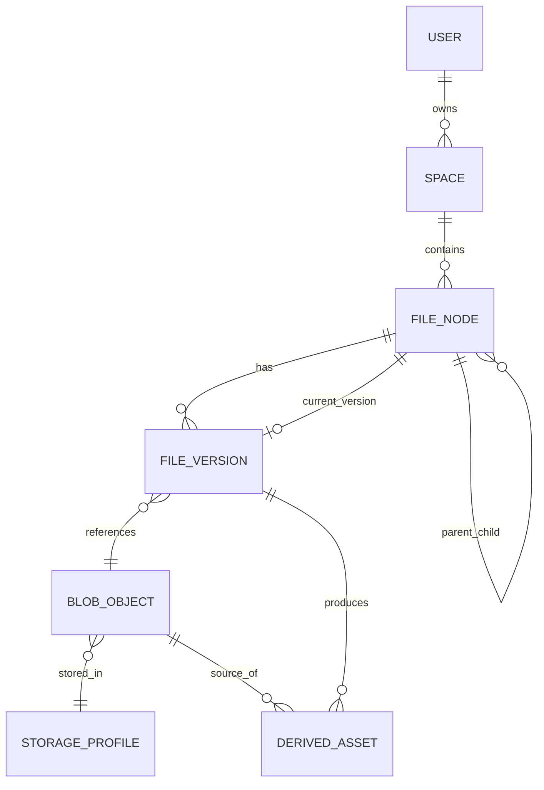
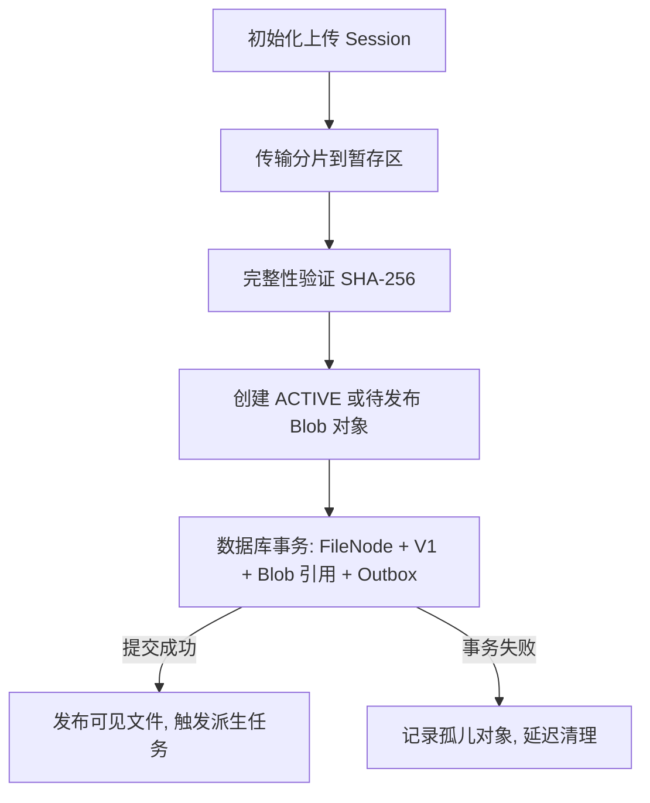

# T003｜文件、文件版本、物理对象三层模型

> 阶段 00 · 设计基线 V1.0 · 适用于文件、版本、上传、存储、去重、预览和回收模块  
> 本文冻结实体职责和一致性约束，详细 DDL/事务 SQL 在阶段 03/05 设计。

## 1. 核心决策

**FileNode 是用户看见的文件；FileVersion 是该文件某次内容快照；BlobObject 是真实字节；StorageProfile 是字节所在的具体存储实例。**

同名文件、同内容文件和同一文件的不同版本不必一一对应物理文件。任何逻辑上的重命名、移动或收藏不得依赖底层磁盘路径变化。

## 2. 实体关系图



> Mermaid 图中 `current_version` 为可空引用（文件夹无版本；尚未完成上传的文件不能发布为可见文件）。

## 3. 四个核心实体职责

### 3.1 FileNode：文件/文件夹逻辑节点

建议字段：`id, space_id, parent_id, node_type(FOLDER|FILE), name, current_version_id, hidden, revision, created_by, created_at, updated_at, deleted_at`。

- 文件夹只通过 `space_id + parent_id` 组织层级，不直接对应某个物理 Blob。
- 文件节点可以有版本链，但只有一个**当前版本**。
- `revision` 用于乐观并发控制，尤其是移动、重命名和撤销。
- 归属空间由 `space_id` 判断，文件创建者不替代空间所有者权限。
- 逻辑删除保留恢复信息，不立刻删除内容字节。

### 3.2 FileVersion：文件内容快照

建议字段：`id, file_id, version_no, blob_id, size, sha256, created_by, created_at, status, source_version_id`。

- 每次内容替换新增记录，`version_no` 单文件递增；不回退、不重用。
- 移动/重命名/更改展示属性不生成内容版本。
- 恢复 V1 时**创建 V4 等新当前版本**，而不是覆盖或删除 V3。
- 版本策略保留数**包含当前版本**：设置为 5 → 最多当前 1 + 历史 4。
- `blob_id` 可指向与其他版本相同的 Blob（未来去重或恢复）。

### 3.3 BlobObject：二进制内容对象

建议字段：`id, storage_profile_id, object_key, byte_size, sha256, state, created_at, verified_at, deletion_due_at`。

- 存储对象以不可变字节为默认语义；禁止原地覆盖已被版本引用的对象。
- `object_key` 使用不可预测、与用户文件名无关的稳定键，绝不使用未经清洗的原始路径。
- Hash 用于完整性与候选去重；客户端计算结果不可信，需要服务端校验。
- 默认**同一个 Blob 所在实例固定**；迁移时采用新物理对象写入、校验、再切换引用。
- 可维护 `ref_count` 作为优化字段，但**最终物理删除前必须核对真实有效引用**。

### 3.4 StorageProfile：存储实例

建议字段：`id, type(LOCAL|S3|DATABASE), name, settings_ciphertext, status, is_default, created_at, updated_at`。

- 类型相同的存储实例可以存在多个，例如 `s3-prod` 与 `s3-archive`。
- 修改默认实例仅影响**新建立的上传会话**。
- 上传会话创建时必须固定 `storage_profile_id`，防止管理后台切换导致上传混用实例。
- 仍被任何 Blob 引用的实例不得直接删除配置；停用写入不等于禁止历史读取。

## 4. 派生文件与原件分离

`DerivedAsset` 表示缩略图、转码视频、Office → PDF、归档临时预览等，建议字段：`id, source_blob_id, source_version_id, profile_key, output_blob_id, status, generated_at`。

- 派生对象的内容必须与特定版本绑定，而非只与 FileNode ID 绑定。
- 原件永久不被预览转换流程覆盖。
- 处理参数、引擎/版本变更后应能失效重建缓存。
- 读取派生资源需要重新校验**源 FileNode 的当前权限或已授权版本访问**。
- 派生资源的生命周期受任务缓存策略管理，不应被统计为另一个用户可见文件。

## 5. 关键操作的实体变化

| 用户操作 | FileNode | FileVersion | BlobObject | StorageProfile |
|---|---|---|---|---|
| 新建文件夹 | 创建 FOLDER | 无 | 无 | 无 |
| 上传新文件 | 创建 FILE | 创建 V1 | 写入新对象或安全复用 | 记录实际实例 |
| 文件重命名 | 更新 `name/revision` | 无变化 | 无变化 | 无变化 |
| 文件移动 | 更新 `parent/space/revision` | 无变化 | 无变化 | 无变化 |
| 替换内容 | 更新当前版本指针 | 新增下一版本 | 写入新对象或复用 | 可与旧版不同 |
| 恢复历史版本 | 更新当前版本指针 | 新建版本引用旧内容 | 可以直接引用旧 Blob | 不强制迁移 |
| 删除至回收站 | 设置删除状态 | 保留 | 保留 | 保留 |
| 永久删除 | 解除逻辑引用 | 按保留/删除策略清理 | 无引用延迟清理 | 保留配置直到无引用 |
| 创建分享 | 无变化 | 无变化 | 无变化 | 无变化 |
| 存储切默认 | 无变化 | 无变化 | 历史不动 | 变更新上传默认 |

## 6. 上传提交的双系统一致性

MySQL 事务不能回滚已经写入本地磁盘/S3 的对象，采用状态机和补偿：



- `complete` API 必须幂等；重复提交不能生成多个文件/版本。
- 出错时保留必要的上传状态供重试，不能把不完整对象暴露给下载接口。
- 创建或替换前检查目录权限、冲突策略和容量；提交时再次确认。
- 后台任务通过 Outbox 事件启动，不与主数据库事务跨服务强绑。

## 7. 版本替换与恢复并发

例：用户 A 和 B 都在共享目录编辑同一文件。

- 创建新版本前读取 `current_version_id/revision`。
- 请求携带 `expectedVersionId` 或 `If-Match`。
- 当前版本发生变化则返回 **409 VERSION_CONFLICT**，不得静默覆盖他人更新。
- 用户明确选择覆盖或保留副本后才能继续。
- 恢复旧版本同样遵循并发校验，恢复完成后形成新版本。

## 8. 逻辑容量与物理占用

**逻辑容量**：当前与受保留策略保护的版本按归属规则计算的大小（即使两个版本指向同一 Blob 也可各计）。

**物理占用**：去重后的实际存储对象、派生缓存及临时任务文件占用总和，应分别分类统计。

**共享空间**：默认由空间所有者承担配额，不因不同成员上传而改变归属。配额策略对删除、恢复和版本清理一致适用。

## 9. 去重作用域和安全边界（预留 P2）

- P0/P1 先实现安全 Blob 引用结构，不承诺秒传。
- P2 初始仅在**同一用户有权复用的内容范围**查找同 Hash 候选。
- 不能提供「全站是否存在该 Hash」可枚举接口。
- 完整内容签名与受授权候选校验才能允许跳过上传。
- 跨不同存储实例复用、文件加密后的去重以及跨用户物理共享属于独立 ADR。

## 10. 删除和回收的安全顺序

1. FileNode 标记逻辑删除，搜索可见性即时受服务端权限校验影响。
2. 回收期内保留版本、Blob 和恢复路径信息。
3. 永久删除或过期后解除版本引用。
4. 归档派生缓存引用并检测后台任务是否仍在使用内容。
5. 物理 Blob 进入 PENDING_DELETE 安全延迟期。
6. 再次验证无有效引用才执行删除；失败记录并重试。

## 11. 版本与存储实例切换示例

```text
文件 需求文档.docx (FileNode #900)
  当前版本 = V3
  V1 -> Blob #101 -> Local-Primary
  V2 -> Blob #102 -> Local-Primary
  V3 -> Blob #803 -> S3-Primary

管理员在 V2 与 V3 之间切换默认存储；旧版本仍可读取。
```

## 12. 验收用例
- [x] 模型区分逻辑文件、版本、Blob、存储配置。
- [x] 定义重命名/移动不移动原件、不生成版本。
- [x] 定义上传异常补偿、幂等与并发冲突。
- [x] 定义版本数量上限与容量归属。
- [x] 定义对象删除前引用检查。
- [x] 覆盖同一文件不同版本分布在不同存储实例的情况。
- [ ] 详细 DDL 与上传事务 SQL 在 T058/T060/T121 实现时落地并测试。

**T003 完成定义：三层文件模型的职责与数据一致性规则足够明确，可指导后续实体表设计。**
