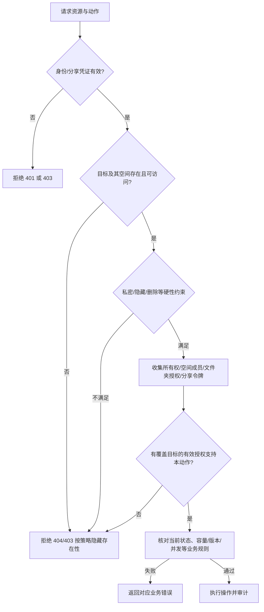

# T004｜共享成员权限矩阵、继承和服务端鉴权规则

> 阶段 00 · 设计基线 V1.0 · 适用于共享空间、共享文件夹、下载、搜索、预览与私密空间

## 1. 身份与授权来源

区分**平台身份**和**资源身份**：

- 平台：`SUPER_ADMIN`、`USER`；平台管理员不自动取得个人私密文件读取权。
- 空间角色：`OWNER`、`MANAGER`、`EDITOR`、`VIEWER`。
- 文件夹授权：对某个资源根节点的 `MANAGER`、`EDITOR`、`VIEWER` 等；文件夹拥有者由源空间所有权推导。
- 外部分享令牌：不是登录用户，不拥有共享空间成员身份，仅在 ShareLink 策略内访问。

**授权始终绑定资源 ID，不能仅靠 URL 或“知道文件 ID”获得访问权限。**

## 2. 标准动作集合

`READ_META` 查看目录与元数据；`PREVIEW` 查看派生资源；`DOWNLOAD` 读取原件；`CREATE` 上传及建目录；`UPDATE` 重命名/替换；`MOVE` 移动；`DELETE` 删除到回收站；`VERSION_READ` 看历史版本；`VERSION_RESTORE` 恢复；`SHARE` 共享资源；`MANAGE_MEMBER` 管理成员；`MANAGE_SPACE` 修改空间；`DISSOLVE` 解散。

## 3. 共享空间角色矩阵

| 操作 | 所有者 OWNER | 管理者 MANAGER | 编辑者 EDITOR | 查看者 VIEWER |
|---|:---:|:---:|:---:|:---:|
| 查看目录/文件元数据 | ✓ | ✓ | ✓ | ✓ |
| 在线预览 | ✓ | ✓ | ✓ | ✓ |
| 下载原件 | ✓ | ✓ | ✓ | 可配置（默认允许） |
| 上传及创建目录 | ✓ | ✓ | ✓ | — |
| 修改/替换文件 | ✓ | ✓ | ✓ | — |
| 移动（同空间） | ✓ | ✓ | ✓ | — |
| 删除资源到回收站 | ✓ | ✓ | ✓ | — |
| 查看历史版本 | ✓ | ✓ | ✓ | 可配置（默认允许） |
| 恢复历史版本 | ✓ | ✓ | ✓ | — |
| 邀请新成员 | ✓ | ✓ | — | — |
| 撤销/修改成员授权 | ✓ | ✓（不能管理 OWNER） | — | — |
| 修改空间展示与策略 | ✓ | ✓（受限） | — | — |
| 转让空间所有权 | ✓ | — | — | — |
| 解散整个空间 | ✓ | — | — | — |

「允许下载」为共享策略限制时，**前端下载按钮、API 获取原件和签名 URL 生成**都必须受到同一规则限制。是否允许下载无法从浏览器层面对所有内容实现绝对的防复制，产品文案不能误导为 DRM 防拷贝。

## 4. 共享文件夹角色矩阵

| 操作 | 源资源所有者 | 文件夹管理者 | 文件夹编辑者 | 文件夹查看者 |
|---|:---:|:---:|:---:|:---:|
| 查看共享根及后代（非隐藏） | ✓ | ✓ | ✓ | ✓ |
| 下载/预览 | ✓ | ✓ | ✓ | 受分享策略限制 |
| 在共享目录上传文件 | ✓ | ✓ | ✓ | — |
| 在共享目录重命名/移动/删除 | ✓ | ✓ | ✓ | — |
| 管理该共享根的受邀成员 | ✓ | ✓（受限） | — | — |
| 访问共享根的父级/兄弟目录 | 依据原空间权限 | **不得通过本授权获得** | **不得获得** | **不得获得** |
| 对私密/隐藏内容授权 | 不允许 | 不允许 | 不允许 | 不允许 |
| 擅自扩大授权到整个源空间 | — | 不允许 | 不允许 | 不允许 |

**文件夹管理者**只管理当前被授权的共享根，不自动成为源空间管理者。首期禁止共享成员将整棵授权子树再转授权给第三人（仅所有者/明确被授权管理者可在原根范围内管理邀请），以控制复杂度。

## 5. 权限继承与有效权限规则

### 5.1 范围继承

授权文件夹 F → 默认覆盖 F 及全部后代（可见且未被更严格机制限制的节点）；不覆盖 F 的祖先、兄弟及其他空间。

建议通过闭包表/受控递归查询判断：`isDescendant(targetId, grantRootId)`。

### 5.2 多个有效授权重叠

例：B 是共享空间 VIEWER，同时被授予其中子文件夹 EDITOR。

首期规则：
1. 收集所有**有效且覆盖目标节点**的成员/文件夹授权。
2. 比较角色许可的动作集合：同动作满足任一有效授权即允许（无显式 DENY 规则）。
3. 额外硬性限制再取交集：私密未解锁、隐藏资源隔离、分享下载禁用、用户禁用、文件状态无效等优先阻断。
4. 角色优先级仅用于 UI 展示；实际权限使用动作集合合并，不能通过字符串比较随意提升。

**说明**：若未来要支持某子目录明确拒绝某成员（DENY），需要升级权限模型，不能直接混入现有 OR 规则。

### 5.3 授权来源独立

撤销共享文件夹授权不影响用户同时存在的共享空间成员权限；退出共享空间也不应错误解除其他独立有效的文件夹邀请。每个授权来源均有唯一 ID 和生命周期。

### 5.4 隐藏与私密

- 私密空间首期禁止任何共享授权及分享链接。
- 资源或任一祖先被标为隐藏时，共享访问者默认不得看到该路径；源所有者通过「显示隐藏项」查看。**隐藏状态不等同于面向所有者的安全密钥**。
- 隐藏资源不能添加快捷访问；隐藏后旧入口失效。
- 拥有 `PREVIEW` 不代表可通过过期缓存绕过下载或私密验证。

## 6. 鉴权决策流程



后端统一接口的概念形式：

```java
PermissionDecision check(UserPrincipal principal, long nodeId, ResourceAction action);
PermissionDecision checkSpace(UserPrincipal principal, long spaceId, ResourceAction action);
```

检查必须在**目录查询、文件列表、元数据、缩略图、原件下载、HTTP Range、预览、历史版本、全文搜索结果与分享页面**所有访问路径覆盖。

## 7. 分享链接专用规则

- 分享链接使用高熵随机令牌，数据库只存摘要。
- 可以单独设置提取密码、有效期限、下载允许、下载次数上限及启停。
- 分享文件夹只允许浏览该分享目标的后代，不授予上级路径。
- 若所有者删除/隐藏源目标、禁用分享或权限策略变化，应立即禁止新访问。
- S3 预签名下载 URL 撤销不总是立即生效，建议短期有效，敏感内容经受控网关读取。

## 8. 前台导航权限处理

- PERSONAL/SHARED 空间在空间列表混排；SHARED 标角色。
- 受邀共享文件夹显示在「共享中心 → 与我共享」，可选择固定到快捷访问。
- 管理后台入口仅向拥有管理员权限的用户显示。
- 已登录普通用户打开后台页面时前端呈现 404，**后台 API 必须返回 403 而不是依赖前端**。
- 「搜索结果可见」不代表搜索引擎已同步全部权限变更；后端必须对候选命中做二次鉴权。

## 9. 典型越权用例

| 用例 | 必须结果 |
|---|---|
| B 猜到 A 的 FileNode ID 并下载 | 拒绝 |
| B 仅拥有共享子目录，却查询父目录 | 拒绝/隐藏存在性 |
| B 从共享空间被移除后使用缓存的预览 API | 拒绝 |
| B 持有旧分享链接，所有者已停用 | 拒绝 |
| 普通用户直接调用 `/api/v1/admin/users` | HTTP 403 |
| 未解锁私密空间直接请求缩略图 | 拒绝 |
| 隐藏目录下新增文件被共享成员搜索到 | 拒绝 |
| B 是共享空间 VIEWER + 文件夹 EDITOR | 在该文件夹内允许编辑，在空间其他目录仍只读 |
| B 移动共享资源到本人空间以窃取所有权 | 默认禁止，必须符合显式复制/移出规则 |

## 10. 验收检查表
- [x] OWNER/MANAGER/EDITOR/VIEWER 四角色定义完备。
- [x] 共享空间和文件夹动作矩阵均已给出。
- [x] 祖先授权、重叠授权、撤销和隐藏边界均已定义。
- [x] 明确了公共分享、管理员和私密机制的权限边界。
- [x] 列出了 API/搜索/预览越权测试。
- [ ] 二级目录显式拒绝、跨所有者移动等复杂扩展需后续 ADR 决策。

**T004 完成定义：后续共享模块可据此实现统一 `PermissionService`，不得为每个页面分别拼凑权限。**
