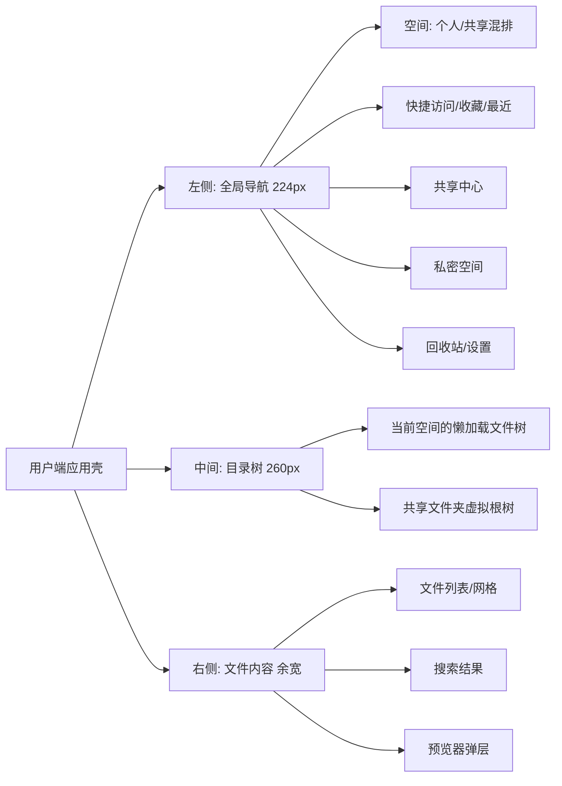

# T005｜PC 导航信息架构、页面清单与路由约定

> 阶段 00 · 设计基线 V1.0 · 用户端 + 管理后台  
> 原则：空间是一级资源容器，文件夹是目录树节点，共享文件夹是**虚拟访问入口**，管理后台是独立布局。

## 1. PC 用户端固定信息架构



默认宽度为设计起点而非硬编码：导航栏建议 216–240px，树栏建议 240–320px，右侧区域自适应；树栏允许拖拽调整宽度，左右导航允许折叠。

### 1.1 左侧一级分组

```text
Cloudlane

空间                        [+]
  ● 我的空间
  ● 工作空间
  ◉ 项目协作空间         共享 · 所有者
  ◉ 团队资料库           共享 · 编辑者

常用工具
  ⌁ 快捷访问
  ☆ 我的收藏
  ◷ 最近使用

协作与安全
  ⇄ 共享中心
  🔒 私密空间
  ♲ 回收站

其他
  ⚙ 个人设置

[容量使用概览]
[用户头像 · 账户菜单]
```

**关键选择**：共享空间和个人空间不分开成两个一级列表；两者按用户自定义顺序混排，辅以共享标记和角色标签。私密空间作为专门的受保护入口，不纳入普通空间展示列表。

### 1.2 共享中心二级导航

```text
共享中心
├─ 与我共享         （文件夹授权的聚合）
├─ 我发起的共享     （我共享给其他成员的文件夹）
└─ 分享链接         （对外链接）
```

用户加入的**共享空间**仍然出现在「空间」列表；共享中心可以提供「我加入的共享空间」快捷筛选，但不作为唯一入口。

### 1.3 中间目录树的复用

| 当前一级页面 | 中栏内容 | 右栏内容 |
|---|---|---|
| 普通/共享空间 | 当前空间目录树 | 目录文件列表 |
| 与我共享 | 共享文件夹根节点聚合或选中的授权子树 | 文件/文件夹列表 |
| 快捷访问 | 固定目录引用列表 | 选中的目录内容 |
| 收藏 | 收藏分类/过滤 | 收藏文件和文件夹 |
| 最近使用 | 日期/类型筛选（可选） | 最近访问文件 |
| 搜索结果 | 搜索范围与类型筛选 | 分类/高亮结果 |
| 设置 | 设置分组导航 | 设置表单 |
| 回收站 | 空间范围筛选 | 已删除资源 |
| 私密空间 | 解锁后私密目录树 | 私密文件列表 |

用户始终在同一个文件工作台视觉系统中进行资源操作，避免为每一种入口开发重复的文件页面。

## 2. 顶部全局工具栏

固定内容（按重要性排序）：
1. 当前路径面包屑或当前页面标题。
2. 全局搜索入口（Ctrl/Cmd+F 聚焦应用内搜索）。
3. 上传任务图标和进行中数量。
4. 消息中心及未读数量。
5. 用户头像；管理员可额外看到「进入管理后台」。

搜索可采用全局弹层 + 独立结果页组合：输入即时建议，Enter 打开完整结果页。

## 3. 右侧文件工作区层次

```text
页面标题 / 当前文件夹名称        [新建文件夹] [上传]
路径面包屑
空间标记 · 文件夹统计 · 共享角色/成员入口
────────────────────────────────────
全部(30) 图片(12) PDF(6) 视频(4) 其他(8)
                                       [列表/网格] [排序] [更多筛选]
────────────────────────────────────
文件列表 / 文件网格 / 空状态
────────────────────────────────────
选中资源工具栏 / 分页 / 状态反馈
```

操作图标应尽量有 `title/aria-label`，不要只依赖悬停才能发现主要功能。

## 4. 页面路由清单（前后端不耦合）

### 4.1 公共页面

| 路由 | 页面 | 权限 | 阶段 |
|---|---|---|---|
| `/auth/login` | 登录 | 游客可见 | P0 |
| `/auth/register` | 注册 | 取决于后台开放注册策略 | P0 |
| `/auth/forgot-password` | 找回密码 | 游客可见 | P1 |
| `/share/:token` | 公开分享访问 | 链接令牌/提取码 | P1 |
| `/404` | 404 | 任意 | P0 |

### 4.2 用户端

| 路由 | 页面 / 交互 | 阶段 |
|---|---|---|
| `/app` | 重定向到默认空间或用户首选入口 | P0 |
| `/app/spaces/:spaceId` | 空间根目录 | P0 |
| `/app/spaces/:spaceId/folders/:folderId` | 空间指定文件夹 | P0 |
| `/app/quick` | 快捷访问 | P1；P0 可保留入口 |
| `/app/favorites` | 收藏 | P1 |
| `/app/recent` | 最近使用 | P1 |
| `/app/shared/received` | 与我共享的文件夹 | P1 |
| `/app/shared/received/:shareId` | 共享文件夹虚拟根 | P1 |
| `/app/shared/sent` | 我发起的共享 | P1 |
| `/app/shared/links` | 分享链接管理 | P1 |
| `/app/private/:spaceId` | 私密空间，未解锁时显示验证态 | P1 |
| `/app/trash` | 回收站 | P0 基础 |
| `/app/search` | 全局搜索结果（query 参数） | P1；P0 可先实现元数据搜索 |
| `/app/settings/profile` | 个人资料 | P0 |
| `/app/settings/security` | 账户安全 | P0 基础 / P1 完整 |
| `/app/settings/files` | 文件及版本偏好 | P1 |
| `/app/settings/appearance` | 显示偏好 | P1 |

**文件预览路由约定**：默认在当前工作台以弹层展示，同时允许通过 `?preview=<fileId>` 同步 URL 以支持后退与定位。URL 只是上下文提示，不是免鉴权访问凭证。分享页的预览使用分享上下文专用组件。

### 4.3 管理后台（独立应用壳）

| 路由 | 页面 | 阶段 |
|---|---|---|
| `/admin` | 仪表盘 | P0 占位 / P1 功能 |
| `/admin/users` | 用户管理 | P1 |
| `/admin/messages` | 系统消息发布 | P1 |
| `/admin/storage` | 存储配置与实例 | P1 |
| `/admin/storage/migrations` | 存储迁移 | P2 |
| `/admin/settings/site` | 网站基础配置 | P1 |
| `/admin/settings/auth` | 登录/注册配置 | P1 |
| `/admin/settings/files` | 文件、版本和上传策略 | P1 |
| `/admin/tasks` | 后台任务 | P1 |
| `/admin/logs` | 管理审计 | P1 |
| `/admin/404` | 后台不可访问/无匹配页面 | P0 |

登录态用户无管理员身份打开 `/admin/*` 时前端展示 404；后端 `/api/v1/admin/*` 按真实权限返回 403。

## 5. 路由与 UI 状态关系

建议把可分享/可定位的**页面状态**放 URL：
- `spaceId`、`folderId`。
- `shareId`。
- `q` 搜索关键词、`type` 搜索分类（适当编码）。
- `preview` 当前预览文件 ID。

把短期的**交互状态**放 Store/组件：
- 文件多选集合。
- 右键菜单坐标。
- 当前拖拽目标。
- 是否显示高级筛选弹层。
- 预览图片缩放角度。

把长期**偏好状态**持久化：
- 列表/网格视图偏好。
- 树栏宽度、导航折叠。
- 用户默认空间。
- 常用快捷访问排序。

## 6. 导航行为与边界

1. 单击空间：切换当前空间，加载其根目录；可选择恢复上次文件夹位置（用户设置控制）。
2. 进入共享文件夹：面包屑从授权根开始，禁止显示或跳转未经授权的源祖先。
3. 共享成员权限被撤销：当前页立即切换至无访问权限态或共享中心，不继续展示缓存数据。
4. 删除当前目录：定位到仍存在且有访问权限的最近祖先。
5. 私密空间未解锁：只显示解锁界面，不能通过 URL 参数提前获取节点数据。
6. 切换一级视图后保留用户的布局宽度偏好，但清理不兼容的多选和右键菜单状态。
7. 管理后台不能与用户工作台共用全局业务路由 Store，身份基础信息可通过 API 共享。

## 7. 页面空状态与错误态

| 状态 | 预期体验 |
|---|---|
| 空目录 | 显示上传、新建文件夹的主要操作 |
| 无搜索结果 | 显示搜索条件和清除筛选 |
| 分享已撤销 | 展示共享已失效，不显示旧资源内容 |
| 文件无权访问 | 显示无权限/已不可用，不泄露文件名及内容 |
| 私密未解锁 | 独立二次验证，不展示任何历史缩略图 |
| 上传失败 | 保留任务信息，给出重试入口 |
| 大文件树加载 | 节点局部骨架与展开动画，不阻塞整个工作台 |

## 8. 与现有 HTML 原型的映射

已有 PC 原型包含：空间混排、目录树、文件列表、共享中心、搜索、快捷访问、预览弹层、后台入口。这些是**交互参考**，不代表全部功能已正式实现；P0/P1 开发以本文路由和安全边界为准。

## 9. 验收检查表
- [x] 用户端、共享中心、后台的信息架构独立清晰。
- [x] 个人与共享空间混排、共享文件夹虚拟根设计明确。
- [x] 页面路由、权限及版本阶段已列出。
- [x] 面包屑与未授权祖先隔离已定义。
- [x] URL、临时状态、用户偏好的归属已区分。
- [ ] 视觉排版间距与响应式断点需在 T011/T012 通过原型评审锁定。

**T005 完成定义：可据此搭建 Web 用户端和后台的路由树与整体布局。**
