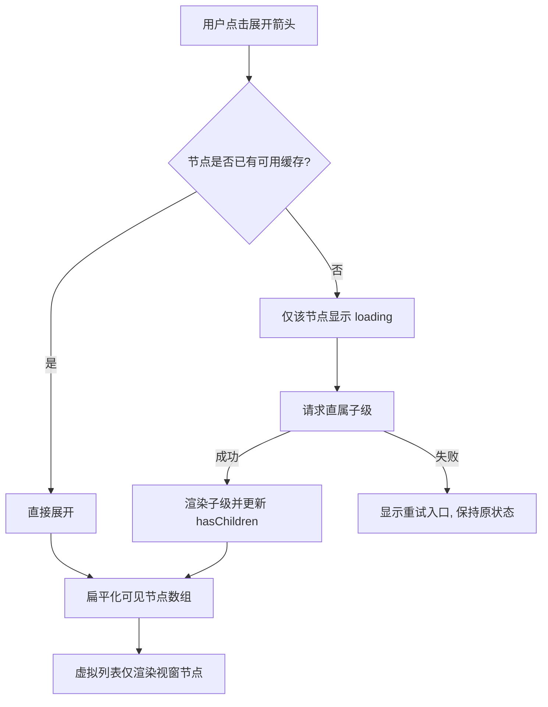

# T006｜文件树、文件工作台和快捷操作交互规范

> 阶段 00 · 设计基线 V1.0 · PC Web 优先 · 面向 FileTree / FileList / PreviewShell 组件

## 1. 基本交互哲学

**单击用于选中和展示上下文，双击用于打开，展开图标用于层级展开。**

目录树和文件内容区域虽然指向同一批逻辑资源，但交互场景不同：
- **树**关注空间结构和定位，常见操作为选中、展开、移动目标。
- **列表/网格**关注文件内容、批量操作和打开预览。
- **共享虚拟根树**遵循同样的操作模型，但不可导航到授权根外。

## 2. 鼠标交互矩阵

| 对象 | 单击 | 双击 | 展开小箭头 | 右键 | 拖拽 |
|---|---|---|---|---|---|
| 树内文件夹 | 高亮，右栏显示其直属内容 | 可等效单击（不重复请求） | 展开/收起直属子级 | 文件夹操作菜单 | 作为移动源或目标 |
| 树内文件（完整树模式） | 选中 | 打开文件预览 | 不适用 | 文件操作菜单 | 可作为移动源 |
| 文件列表中的文件夹 | 选中，显示详情/多选状态 | 进入文件夹，目录树同步定位 | 不适用 | 文件夹菜单 | 允许移动 |
| 文件列表中的文件 | 选中 | 预览器打开 | 不适用 | 文件菜单 | 允许移动 |
| 共享文件夹虚拟根 | 选中并展示可访问内容 | 等效打开 | 展开授权范围内子目录 | 根据角色菜单 | 仅按权限允许操作 |
| 空白区域 | 取消普通选择 | 不触发导航 | 不适用 | 可提供「新建/上传」 | 接受文件上传（有权限时） |

### 2.1 为什么展开箭头独立
点击整行既切换展开状态又更新右侧内容，会产生不易预测的交互：用户可能只想展开树，却意外改变当前目录。所以**箭头只展开，行点击只选择**。用户设置中可增加「单击文件夹名即展开」，但默认不启用。

### 2.2 双击与单击竞争
双击文件的第二次点击可能误触单击行为；实现需让双击具有优先级，避免打开预览前连续发两次目录查询。树节点双击不应反复触发独立导航。

## 3. 目录树状态模型

每个节点：`id, parentId, name, type, hasChildren, loaded, loading, expanded, selected, disabled, hidden`。

全局：
- `activeSpaceId`。
- `activeFolderId`。
- `expandedNodeIds: Set<string>`。
- `selectedNodeIds: Set<string>`（P0 目录树单选，文件列表多选）。
- `loadingNodeIds`。
- `draggingNodeIds`。
- `dropTargetId`。

**注意**：URL 或 Pinia 中的展开缓存只记录已加载标识，真实子节点仍以服务端返回为准。不要把整棵树所有子节点一次性放进 Store。

## 4. 目录树加载行为

- 展开不改变右侧工作区当前文件夹。
- 用户快速收起时不一定取消请求，但晚到响应不得把节点重新展开。
- 切换空间后旧请求结果不得写入新空间树。
- 树滚动位置在同一空间返回时可恢复。
- `hasChildren=false` 不显示可点击箭头。

## 5. 右侧列表与类型切换

### 5.1 当前目录展示
- 右侧默认展示直属文件夹与文件。
- 顶部自动显示真实存在的文件类型；无对应类型不显示标签。
- `全部` 计数默认文件个数；文件夹数量独立展示，不混淆。
- 切换类型筛选不改变目录树位置；清空筛选恢复全部直属内容。
- 「包含子目录」显式开启时才执行递归范围查询。

### 5.2 视图模式
- 列表/网格自由切换，保持当前空间和文件夹。
- 排序支持名称、修改时间、大小；空字段稳定排序。
- 大目录使用分页或虚拟滚动，不要求滚动到尽头才知道文件总量。

### 5.3 单选和多选
- 单击文件行：选中。
- Ctrl/Cmd + 单击：切换单项选择。
- Shift + 单击：以锚点连续选择当前已加载范围。
- Ctrl/Cmd + A：选中当前列表已加载结果；若支持全目录选择需要明确提示「全部 N 项」。
- 选中后出现悬浮批量工具栏（移动、复制、下载、删除、更多）。
- 跨目录切换默认清空选择，避免误操作其他目录中的残留选中项。

## 6. 右键菜单

### 6.1 文件菜单
`预览 / 下载 / 重命名 / 移动 / 复制 / 版本历史(P1) / 分享(P1) / 收藏(P1) / 隐藏(P1) / 详情 / 删除`。

### 6.2 文件夹菜单
`打开 / 新建子文件夹 / 上传至此 / 重命名 / 移动 / 复制 / 共享(P1) / 固定到快捷访问(P1) / 收藏(P1) / 隐藏(P1) / 详情 / 删除`。

### 6.3 菜单规则
- 不同角色按权限隐藏或禁用危险操作，但服务端仍负责授权。
- 多选时菜单只显示批量可执行动作。
- 菜单支持键盘 Esc 关闭、上下键切换、Enter 执行。
- 菜单不能被视口边界裁剪；应自动翻转/偏移。
- 不可执行状态要有原因说明，例如「该共享目录仅可查看」。

## 7. 文件夹新建与重命名

### 7.1 新建文件夹
点击新建 → 插入编辑占位行 → 聚焦文本框 → Enter 提交 / Esc 取消 → 成功后自动高亮该目录并同步树与列表。

- 空名称、非法字符、同父级同名给出就地错误。
- 创建失败不得保留一个看似真实存在的文件夹。

### 7.2 重命名
F2/右键 → 行内输入 → 选中主文件名（扩展名默认不选中） → Enter 提交 / Esc 取消。

- 当前改名不切换目录上下文。
- 服务端并发冲突返回 409；前端保留输入供用户重试。
- 成功后右下方/底部短提示支持**10 秒撤销**（T129 正式实现）。

## 8. 拖拽交互

### 8.1 文件/目录移动
- 开始拖动：拖拽源半透明，显示文件数量。
- 滑过合法目录：目标高亮，显示「移动至 ××」。
- 滑过非法目标：禁止图标及原因（自身、后代、无写入权限、跨所有者限制）。
- 放下：必要时确认，提交 API；成功更新来源/目标缓存和树结构。
- 失败：还原原位置并提示具体原因。

### 8.2 文件夹循环约束
不可把 F 移到自身或任何后代；前端预检查提升体验，后端按当前数据重做最终校验。

### 8.3 跨空间操作
拖动到另一个空间属于敏感归属操作；P0 先支持同空间移动。跨所有者共享空间默认不允许直接移动，必要时引导复制。

### 8.4 外部拖入
浏览器外部文件拖至工作区 → 显示上传投放层 → 指示目标文件夹 → 校验权限后创建上传任务；不把外部拖入误识别为内部文件移动。

## 9. 面包屑

- 显示：`工作空间 / 项目A / 设计 / 图标`。
- 点击祖先：更新当前目录、树节点选中状态并在必要时懒加载祖先链。
- 过长路径中间层折叠进弹出菜单。
- 共享文件夹面包屑从共享虚拟根开始，不暴露原空间未授权祖先。

## 10. 快捷键规范

| 快捷键 | 作用范围 | 行为 |
|---|---|---|
| Ctrl/Cmd+A | 文件列表 | 全选当前可选择项 |
| Ctrl/Cmd+C | 文件列表 | 复制资源引用 |
| Ctrl/Cmd+X | 文件列表 | 标记剪切资源 |
| Ctrl/Cmd+V | 当前有写入权限的目录 | 粘贴并提交操作 |
| Ctrl/Cmd+F | 工作台非输入态 | 聚焦应用搜索 |
| F2 | 选中一个可编辑资源 | 重命名 |
| Delete | 有选择且非文本输入 | 删除至回收站（确认按场景） |
| Enter | 当前列表选择 | 文件夹进入 / 文件预览 |
| Esc | 当前弹层/选区 | 关闭当前最高层 UI 或清空选择 |
| ← / → | 树节点焦点 | 折叠 / 展开 |
| ↑ / ↓ | 树/列表焦点 | 移动焦点 |

快捷键必须忽略 `input/textarea/contenteditable` 内的输入、系统原生弹窗以及正在组合输入的 IME 状态。

## 11. 十秒撤销交互（P1）

示例：`已将「设计.png」移至「图标」 · [撤销]`。展示 10 秒。

规则：
- 仅展示当前可撤销动作；每个操作记录 `operationId`。
- 撤销点击后服务端核对操作版本、权限和并发状态，不能盲目反向更新。
- 支持：重命名、同空间移动、删除至回收站、收藏变更、部分可逆的批量操作。
- 不支持：永久删除、不可恢复物理清理。
- 提示消失不表示操作被反转；仅表示快捷撤销机会到期。

## 12. 预览交互

- 双击文件打开全屏或大弹层 PreviewShell。
- 公共操作：文件标题、关闭、下载、历史版本（有权限时）、上/下文件。
- 图片：滚轮缩放、拖拽、旋转、翻转、重置。
- PDF：缩放、翻页、目录、搜索。
- 视频：倍速、播放、进度、音量、全屏。
- Office：只读分页/表格模式；未完成转换显示进度状态。
- 关闭预览后返回原来文件列表位置和选中状态。
- 图片旋转/缩放**只改变预览状态**，不自动修改原文件。

## 13. 加载、失败与反馈

| 场景 | 交互反馈 |
|---|---|
| 文件夹展开请求中 | 节点局部转圈，其余树可操作 |
| 空文件夹 | 空状态 + 新建/上传 CTA |
| 无权限移动 | 禁用拖放并说明原因 |
| 批量操作部分失败 | 显示成功与失败项明细 |
| 文件预览转换中 | 展示转换中与重试/下载原件 |
| 网络离线 | 提示离线；不伪造保存成功 |
| 空间/共享授权失效 | 清空敏感预览，进入无权限状态 |
| 深层树节点延迟加载 | 展示加载状态，不造成整页闪烁 |

## 14. 基础无障碍和触控预留

- 文件树采用 `role=tree/treeitem` 等语义或成熟可访问性基元。
- 焦点可见；图标按钮有可读标签；高亮不只依赖颜色。
- 右键菜单必须有键盘替代；拖拽必须有「移动到」对话框替代。
- 移动 APP 后续采用长按代替右键，不能把鼠标悬停当成唯一入口。

## 15. 验收用例
1. 只点箭头展开树，右侧目录不切换；点击节点行才切换。
2. 五级文件夹面包屑可逐级返回，树选中同步。
3. Ctrl/Shift 多选和文本输入互不干扰。
4. 拖动父目录到自己后代时明确拒绝；后端也拒绝。
5. 已撤销共享的节点不会继续呈现缓存内容。
6. 重命名成功弹出 10 秒撤销，在时限内可尝试恢复，冲突有解释。
7. 大树只渲染可见节点，不在根节点首次加载所有数据。
8. 预览关闭后保留工作区原滚动位置。

**T006 完成定义：组件开发、自动化 UI 测试和设计评审可共同依照本交互契约执行。**
